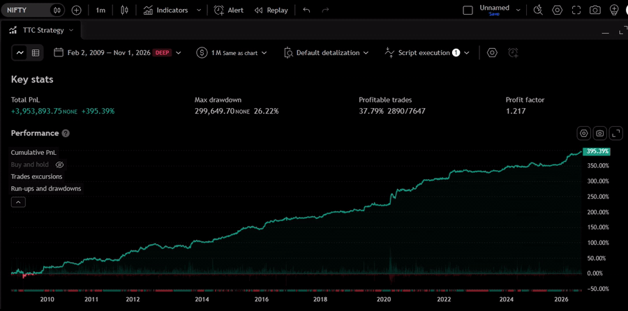

# Documentation of TTC Strategy and Optimiser

## 1. What is TTC Strategy?


TTC Strategy is a trading strategy that identifies potential buying and selling opportunities based on market trends and support and resistance levels.

It uses custom calculations that combine trend analysis with support and resistance to generate trading signals.

The strategy displays its signals through coloured columns:

- **Green Columns:** Indicate a bullish signal and trigger a long (buy) trade.
- **Red Columns:** Indicate a bearish signal and trigger a short (sell) trade.

In simple terms, the strategy takes a long position when its columns turn green and a short position when they turn red.

The strategy has two adjustable inputs (Input 1 and Input 2). These inputs control its calculations and influence how it responds to market movements.

However, finding the right input settings can be challenging because market conditions and behaviour change over time. Settings that perform well on one symbol or timeframe may not perform equally well on another.

This is where TTC Optimiser comes in.

## 2. What is TTC Optimiser?


TTC Optimiser is a tool designed to find the best-performing input settings for TTC Strategy.

Like other trading indicators and strategies, TTC Strategy's performance can vary depending on market conditions, the trading symbol, and the timeframe. As market behaviour changes, its effectiveness can also change.

This makes it difficult to determine whether the current input settings are still suitable for the market or whether they need adjustment.

**TTC Optimiser solves this problem by automatically testing different combinations of input settings and identifying the ones that have performed best on the selected chart.**

### How Does TTC Optimiser Work?

TTC Strategy has two adjustable inputs:

- Input 1
- Input 2

TTC Optimiser tests **800 different combinations(in default setting)** of these two inputs.

For every combination, it runs a backtest of TTC Strategy using the available chart data and analyses the resulting performance report.

After comparing all combinations, it identifies and displays the **top 5 best-performing parameter combinations** based on your selected performance criteria.

This allows you to quickly identify which settings have historically performed best for a particular symbol and timeframe without manually testing hundreds of combinations.

## How to Use the TTC Optimiser

### Steps

1. Add the **TTC Optimiser** to your chart.
2. Configure the optimisation settings according to your requirements.
3. Run the optimiser and note the best-performing parameters.
4. Enter the selected parameters into the **TTC Strategy**.
5. Review the strategy's backtest report to determine whether its performance meets your requirements.
6. If the results are satisfactory, consider using the strategy for further analysis or as part of your trading strategy.


**In simple terms:** TTC Strategy generates trading signals, while TTC Optimiser helps you find suitable input settings for that strategy by systematically testing and comparing different parameter combinations.

## 3. Optimiser Features/Settings

TTC Optimiser offers several features that allow you to configure how the best-performing parameters are identified and selected. Using these features, you can customise the optimisation process according to your trading preferences and requirements.

### A. Optimisation Criteria


Different traders have different priorities. Some prefer strategies that generate higher profits, while others prioritise trading accuracy.

TTC Optimiser provides two main criteria for ranking parameter combinations:

**1. Highest Profitability**

Finds the parameter combinations that generated the highest profit during the backtest.

**2. Highest Accuracy**

Finds the parameter combinations that achieved the highest trading accuracy (win rate).

Based on your selection, the optimiser ranks the tested combinations and displays the top 5 results.

This gives you the flexibility to choose settings according to your trading preferences and objectives.

### B. Parameter Configuration


TTC Optimiser provides a dedicated group of settings that allows you to configure which parameter combinations should be tested for TTC Strategy.

Using these settings, you can define the range of values and the steps between values for both Input 1 and Input 2.

This gives you control over the optimisation process and allows you to focus on the parameter ranges you want to explore.

### Parameter Configuration Modes

The TTC Optimiser provides two modes for configuring parameter ranges:

1. **Custom Configuration**
2. **Prebuilt Ranges**

### 1. Custom Configuration


The Custom Configuration mode allows you to define your own parameter ranges and test combinations according to your specific requirements.

It provides six inputs to configure the parameter ranges:

- **Start Input 1:** The starting value of the first parameter.
- **Iteration Input 1:** The number of different values to generate and test for the first parameter.
- **Steps Input 1:** The increment between two consecutive values of the first parameter.
- **Start Input 2:** The starting value of the second parameter.
- **Iteration Input 2:** The number of different values to generate and test for the second parameter.
- **Steps Input 2:** The increment between two consecutive values of the second parameter.

### Example

Let's understand how these inputs work with an example.

Suppose you configure the parameters as follows:

**Input 1:**
- Start Input 1 = 1
- Iteration Input 1 = 5
- Steps Input 1 = 1

**Input 2:**
- Start Input 2 = 0.5
- Iteration Input 2 = 4
- Steps Input 2 = 0.5

INPUT 1 = 1, 5, 1 \
INPUT 2 = 0.5, 4, 0.5 

Based on these configurations, the optimiser generates the following parameter combinations:

| Input 1 | Input 2 values |
|---|---|
| 1 | 0.5, 1, 1.5, 2 |
| 2 | 0.5, 1, 1.5, 2 |
| 3 | 0.5, 1, 1.5, 2 |
| 4 | 0.5, 1, 1.5, 2 |
| 5 | 0.5, 1, 1.5, 2 |

This results in a total of **20 parameter combinations (5 × 4)** being tested.

### 2. Prebuilt Ranges


Prebuilt Ranges are predefined parameter configurations based on ranges in which we have observed the TTC Strategy performing well.

These ranges are designed to help you explore promising parameter combinations without having to configure the inputs manually.

We recommend testing all four prebuilt ranges to get a broader evaluation of the available parameter combinations and identify potentially better-performing settings.

**Each prebuilt range tests 1,000 parameter combinations**, allowing you to evaluate a wide range of configurations with minimal manual effort.

### C. Filtering Optimisation Results


TTC Optimiser also provides several filters to help you narrow down the results and find parameter combinations that meet your requirements.

You can apply the following filters:

- **Minimum Trades:** Excludes parameter combinations that generated fewer trades than the specified minimum.
- **Maximum Trades:** Excludes parameter combinations that generated more trades than the specified maximum.
- **Minimum PnL:** Excludes parameter combinations whose profit and loss (PnL) is below the specified value.
- **Minimum Accuracy:** Excludes parameter combinations whose trading accuracy (win rate) is below the specified percentage.

When these filters are applied, the optimiser displays the top-performing parameter combinations that satisfy all the specified conditions.

**Example:** If you want to find profitable settings that generate at least 50 trades with an accuracy of 60% or higher, you can configure the filters accordingly.

### D. Backtesting Commission Settings


TTC Optimiser includes an input to configure the commission charged on each trade during backtesting.

This allows you to account for trading costs when evaluating the performance of different parameter combinations.

Commission is specified as a percentage and applied to both entry and exit transaction values.

**Formula:**

```text
Commission = (Commission Rate / 100)
             × (Entry Price + Exit Price)
```

For example, with a commission rate of 0.1%, an entry price of 100, and an exit price of 110:

```text
Commission = (0.1 / 100) × (100 + 110)
           = 0.21
```
### E. Long and Short Trade Settings


TTC Optimiser provides separate options to enable or disable long and short trades during optimisation.

This allows you to optimise TTC Strategy according to your preferred trading direction.

- **Both Long and Short Enabled:** Tests the strategy using both buying and selling trades.
- **Long Only:** Tests the strategy using only long (buy) trades.
- **Short Only:** Tests the strategy using only short (sell) trades.


## Performance Reports

The following reports present the backtesting results of the TTC strategy using the best-performing parameter combinations identified by the TTC optimiser, based on the available chart data for the NIFTY 50 Index across eight timeframes: 1-minute, 3-minute, 5-minute, 10-minute, 15-minute, 30-minute, 1-hour and 4-hour.



### Important Note on Backtesting

Due to TradingView's limitations, the optimiser can backtest parameter combinations only on the historical data available on the chart. Therefore, the top-performing parameters identified by the optimiser are based on the available chart data and may not be the best-performing parameters across the entire historical period.


## Important Note

**The optimiser identifies parameters based on historical backtesting results. Past performance does not guarantee future results.**

**Market conditions can change, and parameters that performed well historically may not continue to perform equally well in the future.**

**We recommend independently validating the selected parameters before using them in live trading.**
